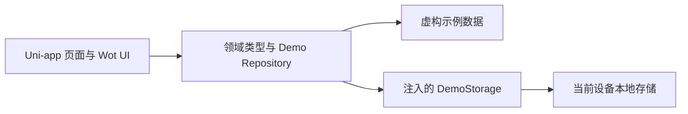
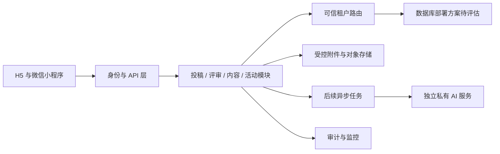

# 架构与后端衔接方案

版本：0.5.1 · 2026-09-21。本文区分当前项目结构与未来方案，不表示后端、鉴权、多租户或外部服务已经实现。

## 1. 当前实现范围

当前项目是**本机运行的 Uni-app 前端演示**，基于 Wot Starter 的工程配置裁剪，使用 Vue 3、TypeScript，已安装 Wot UI。目标编译平台为 H5 和 `mp-weixin`。H5 可用于桌面浏览器中的移动端预览；小程序构建产物仍需微信开发者工具、真实 AppID 与真机验证，不能将 H5 效果视作小程序已完成提审或上线。

当前业务数据由 `apps/miniapp/src/domain` 中的 Mock Repository 提供，没有运行中的 Java 后端、数据库、对象存储、AI 模型或微信登录服务。生成的编号、投稿、收藏、预约均属于单设备、单用户的演示状态。角色展示、地域筛选及本地 `isMine` 标记不提供安全隔离。

Wot UI 提供界面组件，并不自带本项目投稿、评审、报名、权限或业务服务。框架与组件的复用来源、许可证和升级策略以开源选型文档及项目保留的版权声明为准。

## 2. 当前目录职责

| 路径                                                             | 职责                                                           |
| ---------------------------------------------------------------- | -------------------------------------------------------------- |
| `apps/miniapp`                                                   | Uni-app 应用工程；页面、样式、平台配置与运行脚本               |
| `apps/miniapp/src/domain/types.ts`                               | `Work`、`SubmissionDraft`、`Classic`、`Activity` 等领域类型    |
| `apps/miniapp/src/domain/fixtures.ts`                            | 体裁/通道/地区字典、待定评审节点及虚构内容                     |
| `apps/miniapp/src/domain/libraryCatalog.ts`                      | 典籍章节、作品译文、原创释义等演示阅读内容                     |
| `apps/miniapp/src/domain/assistantExamples.ts`                   | 八类双语预设、分镜文本与草稿转入保护，未调用模型               |
| `apps/miniapp/src/domain/writingTools.ts`                        | 富文本 Delta 白名单、受控 HTML 生成与诗词句式计数              |
| `apps/miniapp/src/domain/regionCatalog.ts`                       | 34 个省级地区与海外的中英展示字典                              |
| `apps/miniapp/src/domain/searchCatalog.ts`                       | 九类内容的本机搜索索引与筛选                                   |
| `apps/miniapp/src/domain/accountDemo.ts`                         | 本机登录／认证状态机，非微信授权或真实实名                     |
| `apps/miniapp/src/pkg-content/domain/newsPreferences.ts`         | 分类订阅、提醒频率与免打扰偏好；由资讯分包使用                 |
| `apps/miniapp/src/pkg-content/domain/audioStories.ts`            | 有声故事内容与音源目录；由内容分包使用                         |
| `apps/miniapp/src/pkg-content/domain/hallExperience.ts`          | 场馆空间、人物讲解与互动数据；由内容分包使用                   |
| `apps/miniapp/src/pkg-content/composables/useNewsPreferences.ts` | 资讯偏好的本机存储适配，沿用原存储键                           |
| `apps/miniapp/src/pkg-content/composables/useReplayCache.ts`     | H5与微信回放文件缓存适配，沿用原缓存与索引                     |
| `apps/miniapp/src/pkg-content/composables/useAssetUrl.ts`        | 内容分包资源地址解析，兼容H5开发、生产子目录及微信包内路径     |
| `apps/miniapp/src/domain/localMedia.ts`                          | 诵读／视频文件校验与记录类型                                   |
| `apps/miniapp/src/components/AppShell.vue`                       | 公共头尾、导航、地区及路由上下文，插槽承载页面主体             |
| `apps/miniapp/src/components/ExploreContent.vue`                 | 主包核心业务组件分发                                           |
| `apps/miniapp/src/pkg-content/pages/index.vue`                   | 资讯、课堂、阵地、视频、名人馆、文创、传习分包入口             |
| `apps/miniapp/src/pkg-content/components`、`static`              | 七类内容视图、专属交互组件及其音视频素材，作为分包物理目录组织 |
| `apps/miniapp/src/domain/personalArchive.ts`                     | 摘抄批注、助手存档与注入式本机存储                             |
| `apps/miniapp/src/domain/repository.ts`                          | 稿件查询、草稿、提交、收藏、预约等 Mock 行为与状态保存         |
| `contracts/openapi.yaml`                                         | 未来 HTTP API 的讨论草案，不是已部署接口                       |
| `docs`                                                           | 需求、迭代、开源复用、架构与演示说明                           |

### 2.1 存储注入

`createDemoRepository(storage: DemoStorage)` 只依赖 `getItem(key)`、`setItem(key, value)` 两个方法。界面运行端可将 Uni-app 本地存储适配成该接口；测试可注入内存存储或模拟读写失败。

当前状态包括版本号、编号序列、一个草稿、本地投稿、收藏 ID、预约记录、评审历史、通知与模拟证书，使用 `jiafeng:demo:v1` 存储键。Repository 在持久化成功后才更新内存，以免将写入失败显示成成功。它会检查保存数据的基本结构；这属于演示健壮性处理，不能防止用户篡改本机数据。

单草稿是当前模型，不是原文“云端草稿”的实现。以后若允许同一用户保存多个草稿，需增加草稿 ID、列表、更新时间、并发版本，并调整 API 与页面，不能只把本地键改成网络地址。

### 2.2 当前存储、文件与导出

以下都是单设备数据，不按演示登录身份切分；退出演示账户不会自动删除投稿或学习记录。

| 键或存储位置                                            | 内容与持久化边界                                                                                        |
| ------------------------------------------------------- | ------------------------------------------------------------------------------------------------------- |
| `jiafeng:demo:v1`                                       | 单草稿、稿件、评审、收藏、预约、通知与作品证书；本轮兼容增加 `contentDelta`、`overseasLocation`         |
| `jiafeng:account:v1`                                    | 演示登录与认证资料／状态；不存真实凭据                                                                  |
| `jiafeng:archives:v1`                                   | 完整摘抄、感想与八类助手存档，兼容原有五类记录                                                          |
| `jiafeng:news-preferences:v1`                           | 资讯分类订阅、提醒开关、频率、夜间免打扰；不产生推送                                                    |
| `jiafeng:learning:v1`                                   | 课程学习、测验、活动签到等本机记录                                                                      |
| `jiafeng:showcase:v1`                                   | 视频互动、公益申领与定制记录                                                                            |
| `jiafeng:local-media:v1`                                | 诵读／视频投稿的标题、分类、文件名、大小、时长等元信息，最多保留 100 条；媒体文件路径只在本轮会话内存中 |
| `jiafeng:reflection:<人物ID>`                           | 家训约定文字                                                                                            |
| `jiafeng:live-reminder:v1`                              | 虚构直播提醒的本机开关；没有实际排期或消息                                                              |
| `jiafeng:locale`、`jiafeng:region`、`jiafeng:largeText` | 中英语言、地区、大字偏好                                                                                |
| H5 CacheStorage `jiafeng-replays-v1`                    | 用户主动缓存的回放文件；播放时转为 Blob URL，支持删除；没有 Service Worker 全站离线启动                 |
| 微信 `jiafeng-replays-v1:<回放ID>` 与 `USER_DATA_PATH`  | 包内回放的文件副本与路径索引；读取前检查文件存在，失败反馈，不把路径记录当作文件保存成功                |

附件和用户选择／录制的音视频不通过 JSON 写入本地存储，也不上传对象存储。页面重新加载后保留列表元信息；临时文件丢失时需重新选择，不能承诺媒体内容持久保存。回放缓存属于独立、用户主动执行的文件操作。

`CertificateExport` 以相同数据生成带“演示样张”标识的实际 PNG：H5 使用 Canvas 与 Blob 发起下载；微信使用 Canvas 临时文件及保存相册 API，并处理权限拒绝与重试。画布描摹采用类似平台接口。H5 下载请求成功不等于文件已落盘，微信接口代码与编译也不能替代真机权限验收。

### 2.3 富文本与旧稿兼容

`SubmissionDraft`、`Work` 保留原 `content: string`，增加可选 `contentDelta`。`WritingEditor` 复用 Uni-app editor：H5 条件导入本地 Quill 1.3.7，微信使用终端 editor，不将 Quill 放入微信静态资源。供应代码与 BSD 声明保存在 `src/vendor`。

`writingTools.cleanWritingDelta` 只接受字符串 `insert` 及 `bold/italic/underline/header(2或3)/list(ordered或bullet)`，剔除外部图片、链接、任意样式和其他嵌入。预览 HTML 由 `writingHtml` 从白名单 Delta 和转义后的文字生成，不直接信任编辑器返回或本机保存的任意 HTML。提交检查富文本与纯文本是否一致；搜索、摘要、字数校验等沿用纯文本。旧纯文本稿件按需转换，草稿恢复与同编号重投保留格式，失败不替换既有存储。

就地灵感面板使用本地对话规则与预设；根据当前输入中的收信人、主题等关键词提供框架，并可延续上一轮内容。追加前显示明确确认，在原稿末尾新增文本，保留原段格式。独立助手转稿仍先检查现有普通／修改稿，退回修改稿始终不可被助手覆盖。海外投稿另填 `overseasLocation`，仅作为展示与稿件字段，不构成身份、地域或租户核验。

### 对话演示适配

`domain/localConversation.ts` 提供确定性的本地回复适配与消息类型，输入、回复和上下文分离。当前八种模式使用已编写的材料、关键词匹配及简单文本规则，不请求模型，不进行真实OCR、事实核查或审核。未知问题显示可继续提问的方向，不虚构查证结果。

聊天组件承载气泡记录、输入和消息操作；助手把选中回复送入原有编辑／存档／转稿流程，投稿面板把选中正文交由现有确认追加逻辑处理。对话记录在页面会话内保留，持久保存仍需显式使用原有存档或草稿操作。未来接模型时可以替换回复适配层，但仍需补齐真实服务的异步、鉴权、取消与错误反馈。

### 2.4 页面主体与分包路由

主包 `pages/index/index`、`pages/explore/index` 通过 `AppShell` 的插槽挂载 `ExploreContent`，承载首页、投稿、典藏、评审、个人中心、助手、已有专家／运营视图及搜索。`pkg-content/pages/index` 单独导入 `pkg-content/components` 中的资讯、课堂、阵地、视频、名人馆、文创、传习七类内容组件及专属交互组件；音视频也放入 `pkg-content/static`，使页面与媒体资源具有明确的分包物理归属。公共框架无需静态导入全部内容页面；实际分包体积以构建结果为准。

2026-09-21最终优化将 `audioStories.ts`、`hallExperience.ts`、`newsPreferences.ts` 从 `src/domain` 移入 `src/pkg-content/domain`，将 `useNewsPreferences.ts`、`useReplayCache.ts`、`useAssetUrl.ts` 从 `src/composables` 移入 `src/pkg-content/composables`。这是6个模块的物理归属调整，主包编译后JS合计减少6,984字节；订阅键、回放缓存语义及媒体内容不变。`useAssetUrl` 统一处理H5开发/生产子目录下包内资源地址，避免重复的分包路径。

`mp-weixin.lazyCodeLoading` 为 `requiredComponents`，正式产物与模拟器已确认按需注入启用。它不会自动把主包依赖移入分包，也不等于测得明确的冷启动收益。最终本地逐文件主包为1,547,176字节；13:02开发工具实际复扫中JS Files通过，Main Package和媒体资源项仍未通过。工具按 `compiler.compile` 开发产物的内存文件集逐包检查，覆盖所有分包；同次明细中的主包为1,783,675字节，不能用本地总数代替实际未通过结论。包体与字体方案对比见 [字体对比报告](12-font-comparison.md)。

`useNavigation.screenUrl` 根据 `contentScreens` 选择主包或内容分包入口。一级栏目使用 `reLaunch`，带详情参数且页面栈未满时使用 `navigateTo`，正常返回用 `navigateBack`。每个页面提供独立 route 参数，避免多个页面共享一个可变 screen。原 `pages/explore/index?screen=media&id=...` 等内容链接使用 `redirectTo` 转入分包，保留原参数；旧书签可继续使用。

### 2.5 接口替换的实际边界

当前 Repository 仍是同步方法。`useLearningProgress`、`useShowcase`、`usePersonalArchive`、`useAccountDemo`、`useNewsPreferences` 和 `useLocalMedia` 分别管理本机状态。媒体录制、播放、文件导出与缓存使用终端异步 API，但不因此成为账号、上传或发布服务。

其中资讯偏好、回放缓存和内容资源地址适配现位于 `pkg-content/composables`；其余上述共用状态仍在 `src/composables`。这次移动没有增加服务端接口或改变已有本机记录。

未来 HTTP 访问是异步操作，因此切换到后端时仍需将页面调用与反馈改为异步，并增加加载、取消、重试、会话失效和网络错误处理；不是无改动替换。

建议先定义异步 `PlatformRepository` 接口，将现有 Mock Repository 包装为 Promise 实现，再新增 HTTP 实现。UI 通过应用初始化处选择实现，页面不直接拼接请求 URL。DTO 与领域模型之间设适配层，避免将后端租户、审计或内部存储字段直接暴露给界面。

### 2.6 字体交付与状态

H5由 `styles/fonts.scss` 加载 `src/static/h5/fonts` 中的两份WOFF，`loadFonts.ts` 用 `document.fonts` 核验；本轮H5字体和覆盖不变。微信使用最终选定的 **API＋compact**：`scripts/build-font-subsets.py` 保留全部源码文字与标点，再加200个额外常用汉字，并在裁剪后展开CFF子程序。两份WOFF共569,396字节，每家族1608码点；未收录的用户输入和未来内容使用系统后备字体。

微信字体构建输入位于 `scripts/font-data/mp`，不直接复制到运行包。Vite的 `virtual:jiafeng-wechat-fonts` 校验清单字节与SHA256后内联Data URL；`App.onLaunch` 调用 `loadFonts`，由 `registerWechatFonts` 执行全局 `loadFontFace`，保留真实成功/失败回调、SDK版本检查及8秒状态确认期限。低于基础库3.7.9时提示升级微信，超时表示状态尚未确认，不假称字体已加载或确定渲染失败。不存在运行时读取包内WOFF的流程。

四方案模拟器比较没有证明WXSS能明显改善冷启动，因此保留已有API状态与错误提示。开发工具、手机、字形覆盖和包体是不同验收项；细节见 [字体交付说明](09-fonts.md) 与 [对比基准](benchmarks/font-comparison-2026-09-21.json)。

## 3. 已有字段与契约对应

| 当前领域模型      | API 草案沿用的字段                                                                          | 未来需补足 / 注意                                                                                              |
| ----------------- | ------------------------------------------------------------------------------------------- | -------------------------------------------------------------------------------------------------------------- |
| `SubmissionDraft` | `title`、`content`、`genre`、`channel`、`region`、可选 `author`、`copyrightAccepted`        | 当前同意的是演示声明。正式提交另外绑定协议版本、告知文本和服务端确认记录，不能以单个布尔值声称完成电子签署     |
| `Work`            | `id`、正文/摘要、作者、体裁/通道/地区、状态、`submittedAt`、`progressIndex`、标签、`isMine` | `id` 暂同时作为作品编号；正式是否增加独立公开编号待定。`isMine` 由认证身份计算；公开列表只返回已批准公开的作品 |
| `Classic`         | 标题、副题、作者、正文/摘要、地区、分类、封面颜色、章节数                                   | 未来长篇内容拆为目录/章节；列表中完整正文只是本草案的过渡结构                                                  |
| `Activity`        | 标题、正文、地区、地点、组织方、日期/时段、分类、容量、报名数                               | 未来补充报名窗口、活动状态、时区和取消规则；库存与名额必须由服务端原子校验                                     |
| `Registration`    | `activityId`、`registeredAt`                                                                | 服务端绑定认证用户，不接受客户端传入报名所属用户；正式取消/签到状态另扩展                                      |
| 收藏              | 当前记录作品或典籍的 ID                                                                     | API 采用 `contentId` 与 `contentType`，避免未来不同表 ID 冲突；HTTP 适配层映射回领域对象                       |
| `isDemo: true`    | API 草案中为只读 `boolean`                                                                  | 当前类型仅允许 `true`；未来应通过适配层或显式升级类型支持真实数据 `false`，不能强制伪装成演示或移除来源标识    |

当前 `RegionId` 包含 `all`、34 个省级地区及 `overseas`，提供全国选择结构与无内容状态。现有示例内容仍集中于少数地区，不表示 34 地已有实际运营数据；市／区县正式编码、行政层级和真实数据需独立设计。API 初版枚举尚未同步这些新值。`all` 只表示全国展示或尚未细分的内容归属，不代表任何写入或查看全部租户的权限。

当前 `WorkStatus` 为 `pending_initial_review/in_review/returned/shortlisted/awarded/collected`。退回稿同编号重投，`revisionNumber` 递增；评分、状态、通知与证书通过仓库一次保存，失败时不推进界面状态。当前演示采用逐级晋级后确认入围、授奖和入藏，本轮没有扩展运营后台。生产仍需确认撤回、拒绝、异议与公开发布规则。六级节点仍是原文待讨论的示意，不能由 `progressIndex` 推导正式晋级规则。

## 4. HTTP 契约草案

`contracts/openapi.yaml` 使用 OpenAPI 3.0.3，设计地址为保留域名 `api.example.invalid`，不能调用。它保留初版 12 个核心路径，用于后端讨论，尚未追齐当前评分、消息、证书、附件元信息、富文本 Delta、全国地区、海外字段、认证、订阅及媒体模块新增字段，不能直接据此生成完整后端。新增接口应先确认业务规则，再扩展本契约：

| 领域         | 核心约定                                                                                                             |
| ------------ | -------------------------------------------------------------------------------------------------------------------- |
| 作品         | `GET /works` 支持展示筛选和 `scope=public/mine`；`POST /works` 提交；`GET /works/{workId}/progress` 查询编号对应进度 |
| 草稿         | `GET/PUT/DELETE /me/draft`，暂对应当前一个用户一个草稿                                                               |
| 典籍与活动   | `GET /classics`、`GET /activities`，支持分页与地区过滤                                                               |
| 预约         | `GET/POST /me/registrations`；`DELETE /me/registrations/{activityId}`                                                |
| 收藏         | `GET /me/favorites`；`PUT/DELETE /me/favorites/{contentId}`，显式区分作品/典籍                                       |
| AI（后期）   | `POST /ai/tasks` 仅约定任务受理；任务结果查询、取消、流式输出及回调另立契约                                          |
| 评审（后期） | `GET /review/tasks`、`PUT /review/tasks/{taskId}/score`；服务端提供规则版本和评分维度，不假定六级配置已定            |

当前示例列表携带正文，便于对照本地模型。正式大数据量场景应新增详情与章节接口、将列表改为摘要投影；这应作为契约版本变更实施。当前草案不覆盖生产系统全部功能，也不包含登录、角色管理、总库同步、运营内容发布、支付或文件服务接口。

### 4.1 身份、租户与地区

- 使用服务端签发或验证的 Bearer 凭据。当前项目未实现该凭据的申请、刷新与吊销。
- **租户由服务端基于身份、成员关系与可信路由确定**；不接受前端 `tenantId`、可伪造的租户请求头或地区选择作为授权依据。
- `region` 只用于展示过滤，读取结果仍与用户允许范围取交集；写入地区必须符合服务端业务范围。请求其他地区不能扩大权限。
- `scope=mine` 必须登录，服务端从身份推导用户；公开模式仅返回批准公开的字段和内容。演示种子中“评审中”作品可以展示给体验者，不应照搬到正式公开列表。
- 作品进度、个人收藏、报名和草稿需要本人或明确授权的运营身份；评审任务仅对被分配专家和授权管理者开放，正文与身份按盲审规则裁剪。

### 4.2 写入、重复提交与并发

- `POST /works`、`POST /me/registrations`、`POST /ai/tasks` 必须携带 `Idempotency-Key`。服务端按“已认证身份、可信租户、路径、键”保存请求摘要和响应；同键同载荷重放原结果，同键不同载荷返回 `409`。有效期需在上线前结合重试窗口确认。
- 预约还需数据库唯一约束与名额原子处理；幂等键不代替防超卖和防重复报名约束。
- `PUT/DELETE` 收藏采用显式目标状态，避免网络重试重复切换；本地 `toggleFavorite` 需要由适配层转为“设为已收藏/取消收藏”。
- 草稿与评分用 `ETag` / `If-Match` 做乐观并发控制。客户端先读版本再写，过期返回 `412`，未携带条件头返回 `428`。首次空草稿由 GET 返回空值及初始 ETag。
- 正式评分由服务端验证任务归属、规则版本、可提交时间、各维度范围与任务状态；不得以 UI 禁用按钮代替检查。

### 4.3 分页与错误

列表统一使用 `cursor`、`limit`（建议默认 20、最大 100）及 `{ items, nextCursor }`。游标是与筛选和身份范围绑定的不透明字符串，不能让客户端自行构造内部主键/租户游标。

错误统一为 `{ code, message, requestId, fieldErrors? }`：`401` 未登录或会话失效，`403` 无操作权限，`404` 不存在或不公开，`409` 状态/幂等冲突，`412` 版本过期，`422` 字段不合法，`428` 缺少并发条件，`429` 限流，`503` 暂时不可用。`requestId` 用于问题定位，不泄露内部 SQL、连接信息、凭据或未授权内容。

### 4.4 附件与预签名上传的后续范围

本次 API 草案只接受正文，**不实现上传，也不包含已可调用的预签名端点**。原文图片/PDF/Word 要求进入 P1 后单独补全：

1. 登录用户申请上传，服务端检查允许的 MIME、扩展名、声明大小、数量、用户配额和业务归属。
2. 服务端生成不透明附件 ID、受限对象键和短时签名；签名限制方法、目标、长度/类型及到期时间，不能允许任意桶/路径写入。
3. 客户端上传到隔离区，再通知服务端完成；服务端核验实际类型、大小/摘要，并进行恶意文件与内容检查。
4. 只有检查通过、归本人/授权租户且未过期的 `attachmentId` 才能关联作品；投稿接口不接受任意下载 URL。
5. 私密附件下载也需服务端授权；不得直接把对象地址当作永久公开链接。清理未完成上传和未关联对象，定义保留/删除策略。

前端已增加 `themes`、`attachments`、`editingWorkId`、`contentDelta` 和 `overseasLocation`，附件目前只存名称、大小、类型等元信息；实际临时文件路径留在本轮会话内存中。它们并非服务端附件 ID。未来需将正式协议版本、附件 ID 和上传完成接口同步到领域类型、API 与测试。

## 5. 建议的后端演进

原文指定 Java/Spring Boot、MySQL、Redis、Elasticsearch、对象存储与独立私有 AI。建议从可维护的业务模块开始，先验证闭环；检索、缓存和 AI 仅在明确需求与容量后接入。若选现成后台框架，优先复用账户、权限、字典、审计与运营表格，不照搬其电商等无关领域。

图中为后续方案，不是当前已部署系统。全国总库与省级物理分库的边界、同步数据范围、一致性、删除传播和恢复机制必须专项评估；不能直接从演示中的地区筛选实现推导全国架构。当前不声明已具备百万日活、十万并发、1.5 秒首屏、数据合规或私有 AI 能力。

## 6. 推荐下一步

先用现有演示确认投稿字段、入口、状态和活动路径；随后固定异步 Repository 接口、真实身份范围、评审状态机与协议记录模型。接入第一组后端接口时，优先验证跨账户/跨地区越权、重复提交、并发写入、上传失败与状态一致性，再逐步添加规模化服务。测试和构建的实际结果以本项目当轮验证记录为准。
