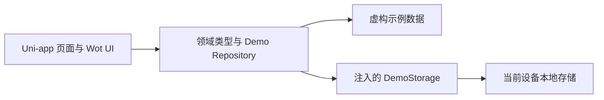
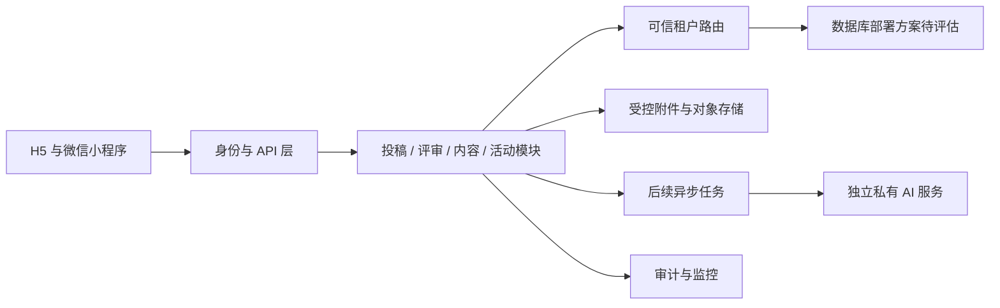

# 架构与后端衔接方案

版本：0.4 · 2026-09-21。本文区分当前项目结构与未来方案，不表示后端、鉴权、多租户或外部服务已经实现。

## 1. 当前实现范围

当前项目是**本机运行的 Uni-app 前端演示**，基于 Wot Starter 的工程配置裁剪，使用 Vue 3、TypeScript，已安装 Wot UI。目标编译平台为 H5 和 `mp-weixin`。H5 可用于桌面浏览器中的移动端预览；小程序构建产物仍需微信开发者工具、真实 AppID 与真机验证，不能将 H5 效果视作小程序已完成提审或上线。

当前业务数据由 `apps/miniapp/src/domain` 中的 Mock Repository 提供，没有运行中的 Java 后端、数据库、对象存储、AI 模型或微信登录服务。生成的编号、投稿、收藏、预约均属于单设备、单用户的演示状态。角色展示、地域筛选及本地 `isMine` 标记不提供安全隔离。

Wot UI 提供界面组件，并不自带本项目投稿、评审、报名、权限或业务服务。框架与组件的复用来源、许可证和升级策略以开源选型文档及项目保留的版权声明为准。

## 2. 当前目录职责

| 路径 | 职责 |
| --- | --- |
| `apps/miniapp` | Uni-app 应用工程；页面、样式、平台配置与运行脚本 |
| `apps/miniapp/src/domain/types.ts` | `Work`、`SubmissionDraft`、`Classic`、`Activity` 等领域类型 |
| `apps/miniapp/src/domain/fixtures.ts` | 体裁/通道/地区字典、待定评审节点及虚构内容 |
| `apps/miniapp/src/domain/libraryCatalog.ts` | 典籍章节、作品译文、原创释义等演示阅读内容 |
| `apps/miniapp/src/domain/assistantExamples.ts` | 五类双语预设与草稿转入保护，未调用模型 |
| `apps/miniapp/src/domain/personalArchive.ts` | 摘抄批注、助手存档与注入式本机存储 |
| `apps/miniapp/src/domain/repository.ts` | 稿件查询、草稿、提交、收藏、预约等 Mock 行为与状态保存 |
| `contracts/openapi.yaml` | 未来 HTTP API 的讨论草案，不是已部署接口 |
| `docs` | 需求、迭代、开源复用、架构与演示说明 |

### 2.1 存储注入

`createDemoRepository(storage: DemoStorage)` 只依赖 `getItem(key)`、`setItem(key, value)` 两个方法。界面运行端可将 Uni-app 本地存储适配成该接口；测试可注入内存存储或模拟读写失败。

当前状态包括版本号、编号序列、一个草稿、本地投稿、收藏 ID、预约记录、评审历史、通知与模拟证书，使用 `jiafeng:demo:v1` 存储键。Repository 在持久化成功后才更新内存，以免将写入失败显示成成功。它会检查保存数据的基本结构；这属于演示健壮性处理，不能防止用户篡改本机数据。

单草稿是当前模型，不是原文“云端草稿”的实现。以后若允许同一用户保存多个草稿，需增加草稿 ID、列表、更新时间、并发版本，并调整 API 与页面，不能只把本地键改成网络地址。

### 2.2 接口替换的实际边界

当前 Repository 为同步方法。新增本地能力也保持此边界：`useLearningProgress` 保存课程/签到，`useShowcase` 保存视频互动与文创记录，`usePersonalArchive` 保存摘抄与 AI 示例；这些是独立本机存储，不是账号服务。

当前页面由 `pages/index/index` 和 `pages/explore/index` 挂载 AppShell。一级栏目用 reLaunch，详情用 navigateTo / navigateBack，并通过每页提供的 route 参数读取内容；正常返回保留上一页筛选和滚动。后续可以将业务视图迁入独立页面/分包。

未来 HTTP 访问是异步操作，因此切换到后端时仍需将页面调用与反馈改为异步，并增加加载、取消、重试、会话失效和网络错误处理；不是无改动替换。

建议先定义异步 `PlatformRepository` 接口，将现有 Mock Repository 包装为 Promise 实现，再新增 HTTP 实现。UI 通过应用初始化处选择实现，页面不直接拼接请求 URL。DTO 与领域模型之间设适配层，避免将后端租户、审计或内部存储字段直接暴露给界面。

## 3. 已有字段与契约对应

| 当前领域模型 | API 草案沿用的字段 | 未来需补足 / 注意 |
| --- | --- | --- |
| `SubmissionDraft` | `title`、`content`、`genre`、`channel`、`region`、可选 `author`、`copyrightAccepted` | 当前同意的是演示声明。正式提交另外绑定协议版本、告知文本和服务端确认记录，不能以单个布尔值声称完成电子签署 |
| `Work` | `id`、正文/摘要、作者、体裁/通道/地区、状态、`submittedAt`、`progressIndex`、标签、`isMine` | `id` 暂同时作为作品编号；正式是否增加独立公开编号待定。`isMine` 由认证身份计算；公开列表只返回已批准公开的作品 |
| `Classic` | 标题、副题、作者、正文/摘要、地区、分类、封面颜色、章节数 | 未来长篇内容拆为目录/章节；列表中完整正文只是本草案的过渡结构 |
| `Activity` | 标题、正文、地区、地点、组织方、日期/时段、分类、容量、报名数 | 未来补充报名窗口、活动状态、时区和取消规则；库存与名额必须由服务端原子校验 |
| `Registration` | `activityId`、`registeredAt` | 服务端绑定认证用户，不接受客户端传入报名所属用户；正式取消/签到状态另扩展 |
| 收藏 | 当前记录作品或典籍的 ID | API 采用 `contentId` 与 `contentType`，避免未来不同表 ID 冲突；HTTP 适配层映射回领域对象 |
| `isDemo: true` | API 草案中为只读 `boolean` | 当前类型仅允许 `true`；未来应通过适配层或显式升级类型支持真实数据 `false`，不能强制伪装成演示或移除来源标识 |

当前 `RegionId` 是 `all/beijing/zhejiang/sichuan`，只是演示字典。正式行政区编码与层级查询需独立设计；草案保留现有值是为字段对照，不代表已经覆盖全国。`all` 只表示全国展示或尚未细分的内容归属，不代表任何写入或查看全部租户的权限。

当前 `WorkStatus` 为 `pending_initial_review/in_review/returned/shortlisted/awarded/collected`。退回稿同编号重投，`revisionNumber` 递增；评分、状态、通知与证书通过仓库一次保存，失败时不推进界面状态。当前演示采用逐级晋级后确认入围、授奖和入藏，生产仍需确认撤回、拒绝、异议与公开发布规则。六级节点仍是原文待讨论的示意，不能由 `progressIndex` 推导正式晋级规则。

## 4. HTTP 契约草案

`contracts/openapi.yaml` 使用 OpenAPI 3.0.3，设计地址为保留域名 `api.example.invalid`，不能调用。它保留初版 12 个核心路径，用于后端讨论，尚未追齐本轮评分、消息、证书、附件元信息及内容模块新增字段，不能直接据此生成完整后端。新增接口应先确认业务规则，再扩展本契约：

| 领域 | 核心约定 |
| --- | --- |
| 作品 | `GET /works` 支持展示筛选和 `scope=public/mine`；`POST /works` 提交；`GET /works/{workId}/progress` 查询编号对应进度 |
| 草稿 | `GET/PUT/DELETE /me/draft`，暂对应当前一个用户一个草稿 |
| 典籍与活动 | `GET /classics`、`GET /activities`，支持分页与地区过滤 |
| 预约 | `GET/POST /me/registrations`；`DELETE /me/registrations/{activityId}` |
| 收藏 | `GET /me/favorites`；`PUT/DELETE /me/favorites/{contentId}`，显式区分作品/典籍 |
| AI（后期） | `POST /ai/tasks` 仅约定任务受理；任务结果查询、取消、流式输出及回调另立契约 |
| 评审（后期） | `GET /review/tasks`、`PUT /review/tasks/{taskId}/score`；服务端提供规则版本和评分维度，不假定六级配置已定 |

当前示例列表携带正文，便于对照本地模型。正式大数据量场景应新增详情与章节接口、将列表改为摘要投影；这应作为契约版本变更实施。当前草案不覆盖生产系统全部功能，也不包含登录、角色管理、总库同步、运营内容发布、支付或文件服务接口。

### 4.1 身份、租户与地区

- 使用服务端签发或验证的 Bearer 凭据。当前项目未实现该凭据的申请、刷新与吊销。
- **租户由服务端基于身份、成员关系与可信路由确定**；不接受前端 `tenantId`、可伪造的租户请求头或地区选择作为授权依据。
- `region` 只用于展示过滤，读取结果仍与用户允许范围取交集；写入地区必须符合服务端业务范围。请求其他地区不能扩大权限。
- `scope=mine` 必须登录，服务端从身份推导用户；公开模式仅返回批准公开的字段和内容。演示种子中“评审中”作品可以展示给体验者，不应照搬到正式公开列表。
- 作品进度、个人收藏、报名和草稿需要本人或明确授权的运营身份；评审任务仅对被分配专家和授权管理者开放，正文与身份按盲审规则裁剪。

### 4.2 写入、重复提交与并发

- `POST /works`、`POST /me/registrations`、`POST /ai/tasks` 必须携带 `Idempotency-Key`。服务端按“已认证身份、可信租户、路径、键”保存请求摘要和响应；同键同载荷重放原结果，同键不同载荷返回 `409`。有效期需在上线前结合重试窗口确认。
- 预约还需数据库唯一约束与名额原子处理；幂等键不代替防超卖和防重复报名约束。
- `PUT/DELETE` 收藏采用显式目标状态，避免网络重试重复切换；本地 `toggleFavorite` 需要由适配层转为“设为已收藏/取消收藏”。
- 草稿与评分用 `ETag` / `If-Match` 做乐观并发控制。客户端先读版本再写，过期返回 `412`，未携带条件头返回 `428`。首次空草稿由 GET 返回空值及初始 ETag。
- 正式评分由服务端验证任务归属、规则版本、可提交时间、各维度范围与任务状态；不得以 UI 禁用按钮代替检查。

### 4.3 分页与错误

列表统一使用 `cursor`、`limit`（建议默认 20、最大 100）及 `{ items, nextCursor }`。游标是与筛选和身份范围绑定的不透明字符串，不能让客户端自行构造内部主键/租户游标。

错误统一为 `{ code, message, requestId, fieldErrors? }`：`401` 未登录或会话失效，`403` 无操作权限，`404` 不存在或不公开，`409` 状态/幂等冲突，`412` 版本过期，`422` 字段不合法，`428` 缺少并发条件，`429` 限流，`503` 暂时不可用。`requestId` 用于问题定位，不泄露内部 SQL、连接信息、凭据或未授权内容。

### 4.4 附件与预签名上传的后续范围

本次 API 草案只接受正文，**不实现上传，也不包含已可调用的预签名端点**。原文图片/PDF/Word 要求进入 P1 后单独补全：

1. 登录用户申请上传，服务端检查允许的 MIME、扩展名、声明大小、数量、用户配额和业务归属。
2. 服务端生成不透明附件 ID、受限对象键和短时签名；签名限制方法、目标、长度/类型及到期时间，不能允许任意桶/路径写入。
3. 客户端上传到隔离区，再通知服务端完成；服务端核验实际类型、大小/摘要，并进行恶意文件与内容检查。
4. 只有检查通过、归本人/授权租户且未过期的 `attachmentId` 才能关联作品；投稿接口不接受任意下载 URL。
5. 私密附件下载也需服务端授权；不得直接把对象地址当作永久公开链接。清理未完成上传和未关联对象，定义保留/删除策略。

前端已增加 `themes`、`attachments` 和 `editingWorkId`，附件目前只存名称、大小、类型等元信息；实际临时文件路径留在本轮会话内存中。它们并非服务端附件 ID。未来需将正式协议版本、附件 ID 和上传完成接口同步到领域类型、API 与测试。

## 5. 建议的后端演进

原文指定 Java/Spring Boot、MySQL、Redis、Elasticsearch、对象存储与独立私有 AI。建议从可维护的业务模块开始，先验证闭环；检索、缓存和 AI 仅在明确需求与容量后接入。若选现成后台框架，优先复用账户、权限、字典、审计与运营表格，不照搬其电商等无关领域。

图中为后续方案，不是当前已部署系统。全国总库与省级物理分库的边界、同步数据范围、一致性、删除传播和恢复机制必须专项评估；不能直接从演示中的地区筛选实现推导全国架构。当前不声明已具备百万日活、十万并发、1.5 秒首屏、数据合规或私有 AI 能力。

## 6. 推荐下一步

先用现有演示确认投稿字段、入口、状态和活动路径；随后固定异步 Repository 接口、真实身份范围、评审状态机与协议记录模型。接入第一组后端接口时，优先验证跨账户/跨地区越权、重复提交、并发写入、上传失败与状态一致性，再逐步添加规模化服务。测试和构建的实际结果以本项目当轮验证记录为准。
